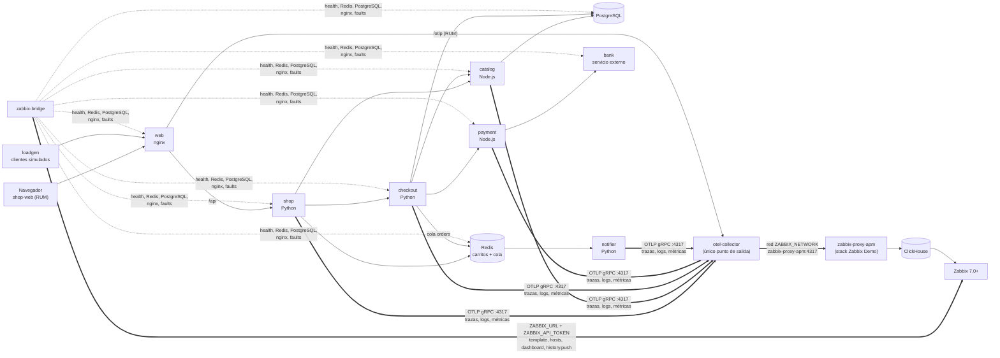

### Business KPIs

Además de trazas y logs, los servicios envían **métricas de negocio** con la API de métricas de OpenTelemetry (mismo exportador y mismo `service.namespace`). Las muestra la pestaña **APM → Overview → fault-shop → Business KPIs** del [módulo APM-Dashboard](https://github.com/SimonLexRS/zabbix-apm-dashboard) y el bridge enlaza al host `apm-fault-shop` el template **APM business metrics by ClickHouse HTTP** ([`zabbix/apm_business_metrics_clickhouse_http.json`](zabbix/apm_business_metrics_clickhouse_http.json)), que las convierte en ítems de Zabbix (por minuto, por hora, hoy, ayer, última hora/24 h, participación y ranking por atributo).

| Métrica | Tipo | Servicio | Atributos (desglose) |
|---|---|---|---|
| `shop.orders` | counter | checkout | `shop.channel` (`web`/`simulado`), `payment.card_type` |
| `shop.revenue` (USD) | counter | checkout | `shop.channel`, `payment.card_type` |
| `shop.order.amount` (USD) | histogram | checkout | `shop.channel`, `payment.card_type` |
| `shop.items.sold` | counter | checkout | `shop.category` (Desk, Audio, Video, Network, Storage, Offers) |
| `shop.orders.failed` | counter | checkout | `shop.failure` (`payment_declined`, `bank_timeout`, `bank_unreachable`, `out_of_stock`, `service_down`, `release_defect`, `service_error`), `shop.channel`, `payment.card_type` |
| `shop.payments` | counter | payment | `payment.card_type`, `payment.result` (`approved`, `declined`, `bank_timeout`, `bank_unreachable`) |
| `shop.cart.additions` | counter | shop | `shop.channel` |
| `shop.emails` | counter | notifier | `email.result` (`sent`/`failed`) |

Cada falla del panel se ve en el negocio: *Pagos fallidos 50 %* sube `shop.orders.failed{shop.failure=payment_declined}` y `shop.payments{payment.result=declined}` y baja `shop.revenue`; *Sin stock* deja `shop.orders` en 0 con `out_of_stock`; *E-mails fallan* sube `shop.emails{email.result=failed}`; la release `1.1.0` produce `release_defect`.

**Configuración** (variables del servicio, ver [sección 6](#6-variables-de-entorno)): el template consulta ClickHouse **desde el Zabbix server**, así que la URL es la que ve el server. Con el stack Zabbix Demo:

```env
ZABBIX_CH_URL=http://clickhouse:8123/
ZABBIX_CH_USER=<CLICKHOUSE_USER del stack Zabbix Demo>
ZABBIX_CH_PASSWORD=<CLICKHOUSE_PASSWORD del stack Zabbix Demo>   # se guarda como macro secreta
ZABBIX_KPI_TIMEZONE=America/La_Paz                               # zona horaria de "hoy"/"ayer"
```

**Dashboard de KPIs** (comparación por canal, tarjeta, categoría y motivo de falla), 2–3 minutos después del primer deploy, con el script del módulo:

```sh
git clone https://github.com/SimonLexRS/zabbix-apm-dashboard.git && cd zabbix-apm-dashboard
export ZABBIX_URL=https://<tu-zabbix> ZABBIX_API_TOKEN=<token>
python3 scripts/zabbix-apm-app.py kpi-dashboard fault-shop      # crea/actualiza "KPIs fault-shop"
```

# Fault Shop · Zabbix + APM (OpenTelemetry → ClickHouse)

[English](README.en.md)

Una tienda pequeña de microservicios en Docker con un **panel de fallas**: interruptores que ponen lenta la base de datos, hacen fallar las compras o apagan un servicio hasta que los apagas. Sirve para ver cómo se ve cada tipo de falla en **Zabbix** (ítems, triggers, dashboard) y en **Zabbix APM** (trazas y logs OpenTelemetry guardados en ClickHouse).

Se integra igual que la [demo de Manufactura](https://github.com/SimonLexRS/Zabbix-Demo-Manufactura): **solo hace falta la URL de Zabbix y un token de API**. Al arrancar, el contenedor `zabbix-bridge` importa el template, crea el grupo, el host de la tienda, el host APM y el dashboard, y empieza a enviar datos. El destino de las trazas se define con una variable (`OTEL_EXPORTER_OTLP_ENDPOINT`).



## Contenido

1. [Qué se crea en Zabbix](#1-qué-se-crea-en-zabbix)
2. [Despliegue en Dokploy](#2-despliegue-en-dokploy)
3. [Despliegue con Docker](#3-despliegue-con-docker)
4. [Destino APM (OpenTelemetry → ClickHouse)](#4-destino-apm-opentelemetry--clickhouse)
   - [Business KPIs](#business-kpis)
5. [Romper algo: el panel de fallas](#5-romper-algo-el-panel-de-fallas)
6. [Variables de entorno](#6-variables-de-entorno)
7. [Alternativa: Zabbix por HTTP agent (pull)](#7-alternativa-zabbix-por-http-agent-pull)
8. [Solución de problemas](#8-solución-de-problemas)
9. [Estructura y desarrollo](#9-estructura-y-desarrollo)

## 1. Qué se crea en Zabbix

Todo lo hace `zabbix-bridge` al arrancar y es idempotente: se puede redesplegar sin duplicar nada.

| Objeto | Nombre | Detalle |
|---|---|---|
| Grupo de templates | `Templates/Applications` | |
| Template | `Fault Shop by Zabbix sender` | 36 ítems trapper + regla LLD de servicios. Archivo: [`zabbix/template_fault_shop_sender.yaml`](zabbix/template_fault_shop_sender.yaml) |
| Grupo de hosts | `Fault Shop` (`ZABBIX_HOST_GROUP`) | |
| Host de la tienda | `Fault Shop` (`ZABBIX_HOST`) | Sin interfaz: los datos llegan por `history.push` |
| Host APM | `apm-fault-shop` (`ZABBIX_APM_HOST_NAME`) | Enlazado al primer template que exista de `Generic OpenTelemetry by OTLP`, `OpenTelemetry application by OTLP`, con sus macros de namespace = `fault-shop`. Se omite si no hay ninguno |
| Dashboard | `Fault Shop · Estado y APM` | Página *Estado de la tienda* y página *APM y faults* |

**Ítems** (claves `fshop.*`, cada 10 s):

| Grupo | Ítems |
|---|---|
| Servicios (LLD `{#SVC}`: web, shop, catalog, checkout, payment, bank) | `fshop.svc.up[{#SVC}]`, `fshop.svc.rt_ms[{#SVC}]`, `fshop.svc.http_code[{#SVC}]` (health check `/health`) |
| Negocio | pedidos totales, pedidos por minuto, pedidos y ventas de los últimos 5 min, ticket medio |
| Redis | disponible, pedidos en cola `orders`, carritos abiertos, memoria, clientes, ops/s |
| PostgreSQL | disponible, tiempo de consulta, conexiones, tamaño de la base |
| nginx | conexiones activas/leyendo/escribiendo/en espera, peticiones por segundo (`stub_status`) |
| notifier | segundos desde su último ciclo (latido en Redis) |
| Panel de fallas | `fshop.fault[<switch>]` por cada interruptor, servicios apagados, switches activos |
| Bridge | `fshop.bridge.heartbeat` |

**Triggers**:

| Trigger | Severidad | Expresión (resumida) |
|---|---|---|
| Fault Shop: zabbix-bridge sin datos | High | `nodata(heartbeat,{$FAULTSHOP.NODATA})=1` — el resto depende de este |
| Servicio {#SVC}: caído | High | `max(svc.up[{#SVC}],#2)=0` |
| Servicio {#SVC}: health check lento | Warning | `min(svc.rt_ms[{#SVC}],1m)>{$FAULTSHOP.RT.MAX}` |
| Redis: caído / PostgreSQL: caído | Disaster | `max(up,#2)=0` |
| PostgreSQL: demasiadas conexiones | Warning | `min(connections,5m)>{$FAULTSHOP.PG.CONN.MAX}` |
| Cola de e-mails acumulada | Average | `min(queue_len,2m)>{$FAULTSHOP.QUEUE.MAX}` |
| notifier: sin actividad | High | `min(heartbeat_age,1m)>{$FAULTSHOP.NOTIFIER.MAX}` |
| Sin pedidos con clientes simulados activos | Average | `max(orders.per_min,{$FAULTSHOP.ORDERS.WINDOW})=0 and last(fault[load_rps])>0` |
| Fault inyectado: <switch> | Info | `last(fault[<switch>])>0`, tag `fault=<switch>` |
| Fault: servicios apagados desde el panel | Warning | `last(fault.down_count)>0` |

Los triggers de trazas (latencia, tasa de errores, sin spans) los aporta el template OpenTelemetry de Zabbix APM en el host `apm-fault-shop`. En Zabbix 8.0, `Generic OpenTelemetry by OTLP` consulta **todo** lo que hay en ClickHouse (no filtra por `service.namespace`): si otras aplicaciones envían OTLP al mismo proxy, sus spans también cuentan en ese host.

## 2. Despliegue en Dokploy

**Requisitos**: Zabbix **7.0 o superior** accesible por HTTPS desde el servidor de Dokploy (p. ej. el stack [Zabbix-Demo](https://github.com/SimonLexRS/Zabbix-Demo)) y, para APM, el proxy `zabbix-proxy-apm` registrado con APM habilitado (ver [sección 4](#4-destino-apm-opentelemetry--clickhouse)).

1. **Token de API en ese Zabbix**: *Users → API tokens → Create API token* para un usuario con rol **Super admin** (necesita importar templates y crear hosts y dashboards). El token es de **un** Zabbix: junto con `ZABBIX_URL` dice explícitamente a cuál reporta la tienda.
2. **Dokploy → Project → Create Service → Compose**:
   - *Provider*: **Git** (o GitHub) → repositorio `https://github.com/SimonLexRS/Zabbix-Demo-Fault-shop.git`, rama `main`.
   - *Compose Path*: `./docker-compose.yml`
   - *Compose Type*: Docker Compose.
3. **Environment** (pestaña *Environment* del servicio). Mínimo:

   ```env
   # A qué Zabbix reporta: su URL (pública, o http://zabbix-web:8080 si comparte la red) y un token de ESE Zabbix
   ZABBIX_URL=https://zabbix.tu-dominio.com
   ZABBIX_API_TOKEN=<token del paso 1>

   # Clave del panel de fallas: sin ella se ven los interruptores pero no se pueden cambiar
   CONTROL_TOKEN=<clave larga y aleatoria>

   # Red del mismo stack Zabbix (su ZBX_SHARED_NETWORK): la telemetría va a zabbix-proxy-apm:4317 por ahí
   ZABBIX_NETWORK=zabbix-lab-prd-02

   # Business KPIs: el CLICKHOUSE_PASSWORD de ese stack Zabbix
   ZABBIX_CH_PASSWORD='<CLICKHOUSE_PASSWORD>'
   ```

   Las cinco son obligatorias: si falta una, el deploy se detiene y la nombra. `otel-collector` es el único servicio de la tienda que envía telemetría fuera: se une a `ZABBIX_NETWORK` y reenvía todo a `zabbix-proxy-apm:4317`, sin puertos del host. Despliega antes el Zabbix: si la red no existe, el deploy falla con `network … declared as external, but could not be found`.

   El resto de variables tiene valores por defecto; la lista completa está en [`.env.example`](.env.example) y en la [sección 6](#6-variables-de-entorno).
4. **Domains**: *Add Domain* → *Service Name* **`web`**, *Container Port* **`80`**, host p. ej. `shop.tu-dominio.com`, HTTPS con Let's Encrypt si quieres.
5. **Deploy**. La primera construcción tarda 2–5 minutos.
6. **Verificar**:
   - Tienda: `https://shop.tu-dominio.com/` · panel de fallas: `https://shop.tu-dominio.com/faults.html`
   - Logs del servicio `zabbix-bridge` en Dokploy: `Provisión OK: {... 'host': 'host creado', 'apm': 'host APM creado'}` y luego `Dashboard: {... 'complete': True}` (≈1 min, cuando la LLD ya creó los ítems por servicio).
   - Zabbix → *Monitoring → Hosts* → `Fault Shop` con *Latest data*, y *Dashboards* → `Fault Shop · Estado y APM`.
   - Estado del bridge desde la terminal de Dokploy (contenedor `zabbix-bridge`): `wget -qO- localhost:8000/api/zabbix/status`.

### Proteger el dominio (Basic Auth reforzado)

La tienda y su panel de fallas no tienen login propio. En Dokploy, *Security → Basic Auth* solo existe para *Applications* y *Forward Auth* (login de Dokploy) requiere licencia Enterprise, así que en un servicio **Compose** se usa un middleware de Traefik:

1. Hash **bcrypt** de la contraseña (no MD5/SHA1): `htpasswd -nbB -C 12 admin '<contraseña larga y aleatoria>'`.
2. Dokploy → *Settings → Traefik → Middlewares* (`middlewares.yml`), añade:

   ```yaml
   http:
     middlewares:
       faultshop-auth:
         basicAuth:
           realm: "Fault Shop"
           removeHeader: true          # la cabecera Authorization no llega a la app
           users:
             - "admin:$2y$12$...hash..."
       faultshop-headers:
         headers:
           stsSeconds: 31536000        # HSTS: solo HTTPS
           stsIncludeSubdomains: true
           contentTypeNosniff: true
           frameDeny: true
           referrerPolicy: "same-origin"
       faultshop-ratelimit:
         rateLimit:                    # frena intentos de fuerza bruta
           average: 30
           burst: 60
   ```
3. Servicio → *Domains* → editar el dominio de `web` → *Middlewares*: `faultshop-auth@file`, `faultshop-headers@file`, `faultshop-ratelimit@file` → *Deploy*.

`loadgen` y `zabbix-bridge` siguen funcionando: van por la red interna (`http://web`), no por Traefik. La telemetría del navegador (`/otlp`) es del mismo origen y reutiliza las credenciales. Para cambiar la contraseña, genera otro hash y reemplaza la línea de `users`.

**Release defectuosa**: pon `CHECKOUT_VERSION=1.1.0` en *Environment* y *Deploy*; vuelve a `1.0.0` para hacer rollback (ver [sección 5](#fallas-que-no-son-un-interruptor)).

**Persistencia**: PostgreSQL usa el volumen `pgdata` (los pedidos sobreviven a redeploys). Redis no persiste a propósito.

## 3. Despliegue con Docker

```sh
git clone https://github.com/SimonLexRS/Zabbix-Demo-Fault-shop.git && cd Zabbix-Demo-Fault-shop
# Con el stack Zabbix-Demo en el mismo Docker: ZABBIX_NETWORK = su ZBX_SHARED_NETWORK.
# Sin Zabbix: docker network create zabbix-local y ZABBIX_NETWORK=zabbix-local (con ZABBIX_DRY_RUN=1).
cp .env.example .env        # edita ZABBIX_URL, ZABBIX_API_TOKEN, CONTROL_TOKEN, ZABBIX_NETWORK y ZABBIX_CH_PASSWORD
docker compose -f docker-compose.yml -f compose.local.yaml up -d --build
docker compose logs -f zabbix-bridge
```

| Página | Dirección |
|---|---|
| Tienda | `http://<IP>:18090/` (`SHOP_PORT`) |
| Panel de fallas | `http://<IP>:18090/faults.html` |
| Métricas del bridge (JSON) | `http://<IP>:18091/api/metrics` (`BRIDGE_PORT`) |
| Estado de la integración | `http://<IP>:18091/api/zabbix/status` |

`compose.local.yaml` solo publica puertos; en Dokploy no se usa porque el tráfico entra por su dominio (Traefik).

Con `ZABBIX_URL=` vacío la tienda funciona igual y el bridge solo expone `/api/metrics`. Para probar sin Zabbix: `ZABBIX_DRY_RUN=1` (escribe en el log lo que enviaría).

## 4. Destino APM (OpenTelemetry → ClickHouse)

Los servicios `shop`, `catalog`, `checkout`, `payment` y `notifier` arrancan con el agente OpenTelemetry de su lenguaje (sin código de telemetría propio) y envían **trazas, logs y métricas** por OTLP gRPC al `otel-collector` interno, que los reenvía al receptor. `bank` (servicio "externo") y `loadgen` no se instrumentan a propósito. Nada en la tienda conoce ClickHouse: eso lo hace el receptor.

### Con el stack "Zabbix Demo" en Dokploy (caso por defecto)

El receptor es el servicio **`zabbix-proxy-apm`** del stack [Zabbix-Demo](https://github.com/SimonLexRS/Zabbix-Demo) (proxy de Zabbix 8.0 con `ZBX_STARTAPMCOLLECTOR=1`): acepta **solo OTLP gRPC en el 4317**, escribe en `clickhouse:8123` (base `zabbix`) y **no publica puertos en el host**. Está en la red Docker `ZBX_SHARED_NETWORK` de su stack, junto con `zabbix-web`.

```
shop, catalog, checkout, payment, notifier ──gRPC──▶ otel-collector:4317 ─┐
navegador ──/otlp──▶ web (nginx) ──HTTP──▶ otel-collector:4318 ───────────┤ red ZABBIX_NETWORK
zabbix-bridge ─────────────────────────────────────────────────────────────┼──▶ zabbix-web:8080 (API)
                                                                           └──▶ zabbix-proxy-apm:4317 (APM)
```

| Dato | Valor |
|---|---|
| Red compartida | `ZABBIX_NETWORK` = `ZBX_SHARED_NETWORK` del stack Zabbix |
| Servicios de la tienda en esa red | solo `otel-collector` y `zabbix-bridge` |
| Servicios → collector | `OTEL_EXPORTER_OTLP_ENDPOINT=http://otel-collector:4317` (gRPC, por defecto) |
| Collector → Zabbix APM | `APM_GRPC_ENDPOINT=http://zabbix-proxy-apm:4317` (por defecto) |
| Bridge → API de Zabbix | `ZABBIX_URL` + `ZABBIX_API_TOKEN` (obligatorias; `http://zabbix-web:8080` si comparte la red) |

**¿Por qué solo dos servicios en la red?** La red es de todo el stack Zabbix: si otra app conectara también su `shop` o su `postgres`, los nombres se mezclarían. Con un único punto de salida, los nombres de la tienda siguen siendo privados y varias apps pueden compartir el mismo Zabbix.

**Prerrequisitos en Zabbix**: el stack Zabbix-Demo los hace solo en cada deploy (servicio `zabbix-setup`, ver su README → *Después del deploy*). Con otro Zabbix:

1. *Administración → Proxies → Crear proxy*: nombre `zabbix-proxy-apm`, modo **Activo**, pestaña **APM** → **Data collection enabled**. Hasta entonces el proxy no abre el 4317 y los exportadores registran *connection refused*. Por API (Zabbix 8.0):

   ```json
   {"jsonrpc":"2.0","method":"proxy.create","id":1,
    "params":{"name":"zabbix-proxy-apm","operating_mode":0,"apm":{"data_collection_status":1}}}
   ```
2. *Administración → Data source → APM*: `http://clickhouse:8123`, base `zabbix`, usuario y clave de ClickHouse.

**RUM (navegador)**: el navegador solo habla OTLP/HTTP, que el proxy no acepta: nginx reenvía `/otlp` → `otel-collector:4318` ([`otel/collector.yaml`](otel/collector.yaml)), que lo pasa a gRPC hacia `APM_GRPC_ENDPOINT`. No hay que configurar nada más.

### Con otro receptor

Cambia solo `APM_GRPC_ENDPOINT` (destino gRPC del `otel-collector` interno), p. ej. `http://<host>:4317` para un proxy APM de Zabbix publicado en otro servidor o un Collector propio. Los servicios siguen enviando al collector interno.

**Notas**

- Con TLS usa `https://...` (y `APM_TLS_INSECURE=false`); con autenticación, `OTEL_EXPORTER_OTLP_HEADERS=Authorization=Bearer%20<token>`.
- **`service.namespace`** (`OTEL_SERVICE_NAMESPACE`, por defecto `fault-shop`) es la "aplicación" en Zabbix APM; el bridge la pone en las macros de namespace del host APM.
- Métricas OTel activadas por defecto (`OTEL_METRICS_EXPORTER=otlp`, cada 60 s): alimentan los [Business KPIs](#business-kpis). Las de runtime/HTTP también se envían, pero el template de KPIs las ignora.
- Prueba rápida del receptor sin la tienda, en el VPS: `docker run --rm --network <ZABBIX_NETWORK> ghcr.io/open-telemetry/opentelemetry-collector-contrib/telemetrygen:latest traces --otlp-endpoint zabbix-proxy-apm:4317 --otlp-insecure --traces 5 --service smoke-api`.

Comprobar que llegan trazas (en el servidor de ClickHouse):

```sql
SELECT ServiceName, count() AS spans, countIf(StatusCode = 'Error') AS errors
FROM zabbix.otel_traces
WHERE ResourceAttributes['service.namespace'] = 'fault-shop' AND Timestamp > now() - INTERVAL 5 MINUTE
GROUP BY ServiceName ORDER BY ServiceName;
```

Debe listar `catalog`, `checkout`, `notifier`, `payment`, `shop` (y `shop-web` tras abrir la tienda en un navegador).

## 5. Romper algo: el panel de fallas

Abre `/faults.html` y enciende una falla. La primera vez pide la **clave de administrador** (`CONTROL_TOKEN`) y la guarda en ese navegador (*Olvidar clave* la borra); sin ella se ven los interruptores pero no se pueden cambiar. Actúa en segundos, sobre los clientes simulados y sobre lo que hagas tú. **Volver todo a la normalidad** apaga todo. Cada switch activo abre el problema *Fault inyectado: …* (Info) en el host `Fault Shop`, así que en Zabbix siempre ves la **causa** junto a los **síntomas**.

| Interruptor | Qué hace | En Zabbix (host `Fault Shop`) | En APM (host `apm-fault-shop`) |
|---|---|---|---|
| **Base de datos lenta** (500 ms, 2 s, 6 s) | Cada consulta de `catalog` tarda ese tiempo | Sube *nginx: peticiones* en espera; con 6 s cae *pedidos por minuto* → *Sin pedidos con clientes simulados activos* | `GET /products` lento; el tiempo está en el span de PostgreSQL. *Span duration is too big* |
| **Consultas N+1** | La lista hace una consulta por producto | Sube *PostgreSQL: conexiones* | Traza de `GET /products`: 17 consultas en vez de 1 |
| **Pagos fallidos** (20, 50, 100 %) | `payment` rechaza esa parte de los cobros | Bajan *pedidos/min* y *ventas*; al 100 %, *Sin pedidos…* | `CardDeclinedError` en `payment`. *High span error rate* |
| **Banco lento** (1 s, 3 s, 6 s) | El servicio externo responde tarde (`payment` espera 4 s) | *Servicio bank: health check lento* si supera `{$FAULTSHOP.RT.MAX}` | Línea lenta `payment → bank`; con 6 s, `BankTimeoutError` |
| **Servicio caído** (`catalog`, `checkout`, `payment`, `bank`) | Responde 503; `bank` cierra la conexión | **Servicio X: caído** (High) + *Fault: servicios apagados* | Nodos en rojo; `BankUnreachableError`, `RuntimeError: payment answered HTTP 503` |
| **Un producto rompe el código** | Solo *Mystery box* (id 13) falla con `TypeError` | Info del fault | Grupo de errores en `GET /products/:id`, `app.product.id = 13` |
| **Sin existencias** | Las compras se rechazan con 409 | *Sin pedidos con clientes simulados activos* | 4xx: nadie "falló", pero sube la tasa de error entre servicios |
| **Checkout con CPU** (200 ms, 800 ms, 2 s) | `checkout` gasta ese tiempo en su código | Info del fault | Span `validate order` sin llamadas dentro |
| **Cola de e-mail lenta** (1 s, 5 s) | `notifier` tarda eso por pedido | **Cola de e-mails acumulada** y sube *notifier: segundos desde su último ciclo* | La traza se alarga en `orders process` |
| **E-mails fallan** | `notifier` no puede enviar | Info del fault | `ConnectionError` en `notifier` mientras las compras salen bien |
| **Error JavaScript en "Add to cart"** | La página se rompe al hacer clic | Info del fault | *Real user monitoring → Errors*: `TypeError` (haz clic tú) |
| **Clientes simulados** (0, 1, 2, 5 por segundo) | El tráfico de `loadgen` | Cambian *nginx: peticiones por segundo* y *pedidos por minuto* | Con 0: *No spans received* a los 10 min |

### Fallas que no son un interruptor

| Falla | Dokploy | Docker | Qué se ve |
|---|---|---|---|
| Caída real de un servicio (conexión rechazada) | Detén el contenedor `payment` desde la pestaña de contenedores | `docker compose stop payment` / `start payment` | *Servicio payment: caído* (código HTTP 0); `ConnectionError` en `checkout` |
| Release defectuosa | `CHECKOUT_VERSION=1.1.0` → Deploy | `CHECKOUT_VERSION=1.1.0 docker compose up -d checkout` | APM → `checkout` → *Versions*: 1.1.0 falla con `KeyError` en pedidos de 3+ productos |
| Rollback | `CHECKOUT_VERSION=1.0.0` → Deploy | `docker compose up -d checkout` | Los errores de la 1.1.0 paran |
| Notifier detenido | Detén `notifier` | `docker compose stop notifier` | *notifier: sin actividad* y *Cola de e-mails acumulada* |
| Base de datos caída | Detén `postgres` | `docker compose stop postgres` | **PostgreSQL: caído** (Disaster), *Servicio catalog/checkout* con errores |
| Toda la app detenida | Stop del servicio | `docker compose down` | *zabbix-bridge sin datos* (2 min) y *No spans received* (10 min) |

## 6. Variables de entorno

**Zabbix** (`zabbix-bridge`)

| Variable | Por defecto | Uso |
|---|---|---|
| `ZABBIX_NETWORK` | — (obligatoria) | Red Docker del stack Zabbix (`ZBX_SHARED_NETWORK`); en ella están `zabbix-web` y `zabbix-proxy-apm` |
| `ZABBIX_URL` | — (obligatoria) | URL del frontend del Zabbix al que reporta (se le añade `/api_jsonrpc.php`) |
| `ZABBIX_API_TOKEN` | — (obligatoria) | Token de API de un Super admin de ese Zabbix |
| `CONTROL_TOKEN` | — (obligatoria) | Clave del panel de fallas: `PUT`/`DELETE /api/faults` exigen la cabecera `x-control-token` |
| `ZABBIX_HOST` | `Fault Shop` | Host de la tienda (y prefijo del nombre del dashboard) |
| `ZABBIX_HOST_GROUP` | `Fault Shop` | Grupo de hosts |
| `ZABBIX_SEND_INTERVAL` | `10` | Segundos entre envíos |
| `ZABBIX_LLD_INTERVAL` | `600` | Segundos entre envíos de la LLD de servicios |
| `ZABBIX_TLS_INSECURE` | `0` | `1` acepta certificados autofirmados |
| `ZABBIX_TRANSPORT` | `api` | `api` = `history.push` por HTTPS · `sender` = protocolo Zabbix sender (TCP 10051) |
| `ZABBIX_SERVER` / `ZABBIX_PORT` | — / `10051` | Server o proxy para `ZABBIX_TRANSPORT=sender` |
| `ZABBIX_DASHBOARD` | `1` | Crear/actualizar el dashboard |
| `ZABBIX_APM_ENABLED` | `1` | Crear el host APM |
| `ZABBIX_APM_TEMPLATE` | `Generic OpenTelemetry by OTLP,OpenTelemetry application by OTLP` | Templates OTLP candidatos (se usa el primero que exista) |
| `ZABBIX_APM_HOST_NAME` | `apm-fault-shop` | Nombre del host APM |
| `ZABBIX_DRY_RUN` | `0` | `1` = no envía nada, solo lo escribe en el log |
| `ZABBIX_KPI_ENABLED` | `1` | Importar y enlazar el template de Business KPIs al host APM |
| `ZABBIX_KPI_TIMEZONE` | `UTC` | `{$APM.KPI.TIMEZONE}`: zona horaria de "hoy" y "ayer" |
| `ZABBIX_KPI_METRIC_MATCHES` | `^shop\.` | Métricas que se convierten en ítems |
| `ZABBIX_CH_URL` / `ZABBIX_CH_DB` | `http://clickhouse:8123/` / `zabbix` | ClickHouse visto desde el Zabbix server |
| `ZABBIX_CH_USER` / `ZABBIX_CH_PASSWORD` | `zabbix` / — | Credenciales de ClickHouse (la contraseña va como macro secreta) |

**APM / OpenTelemetry** (todos los servicios instrumentados)

| Variable | Por defecto | Uso |
|---|---|---|
| `OTEL_EXPORTER_OTLP_ENDPOINT` | `http://otel-collector:4317` | Destino de los servicios: el collector interno |
| `APM_GRPC_ENDPOINT` | `http://zabbix-proxy-apm:4317` | Destino del collector: el proxy APM del stack Zabbix (red `ZABBIX_NETWORK`) |
| `OTEL_EXPORTER_OTLP_PROTOCOL` | `grpc` | Protocolo hacia el collector interno |
| `OTEL_EXPORTER_OTLP_HEADERS` | — | Cabeceras de autenticación |
| `OTEL_TRACES_EXPORTER` / `OTEL_LOGS_EXPORTER` / `OTEL_METRICS_EXPORTER` | `otlp` / `otlp` / `otlp` | Señales enviadas (las métricas alimentan los Business KPIs) |
| `OTEL_METRIC_EXPORT_INTERVAL` | `60000` | ms entre exportaciones de métricas |
| `OTEL_SERVICE_NAMESPACE` | `fault-shop` | `service.namespace` (aplicación en APM) y `{$OTLP.NAMESPACE}` |
| `DEPLOY_ENV` | `demo` | `deployment.environment.name` |
| `RUM_OTLP_HTTP_ENDPOINT` | `http://otel-collector:4318` | Receptor OTLP/HTTP de los spans del navegador (el collector interno) |
| `APM_GRPC_ENDPOINT` | = `OTEL_EXPORTER_OTLP_ENDPOINT` | A dónde reenvía el collector interno (gRPC) |
| `APM_TLS_INSECURE` | `true` | `false` si `APM_GRPC_ENDPOINT` usa TLS |

**Tienda**

| Variable | Por defecto | Uso |
|---|---|---|
| `CHECKOUT_VERSION` | `1.0.0` | `1.1.0` despliega la release defectuosa |
| `SHOP_PORT` / `BRIDGE_PORT` | `18090` / `18091` | Solo Docker (`compose.local.yaml`) |

**Macros del template** (se ajustan en el host o el template): `{$FAULTSHOP.NODATA}=2m`, `{$FAULTSHOP.RT.MAX}=2000` (ms), `{$FAULTSHOP.QUEUE.MAX}=20`, `{$FAULTSHOP.PG.CONN.MAX}=80`, `{$FAULTSHOP.NOTIFIER.MAX}=60` (s), `{$FAULTSHOP.ORDERS.WINDOW}=3m`.

## 7. Alternativa: Zabbix por HTTP agent (pull)

Si prefieres que Zabbix consulte la tienda en vez de recibir datos:

1. Deja `ZABBIX_URL` vacío (el bridge no envía nada, solo sirve `/api/metrics`).
2. Expón el bridge: en Dokploy, un dominio para el servicio **`zabbix-bridge`** puerto **`8000`** (p. ej. `fshop-metrics.tu-dominio.com`, idealmente con Basic Auth o solo en red interna); en Docker, `BRIDGE_PORT`.
3. Importa [`zabbix/template_fault_shop_http.yaml`](zabbix/template_fault_shop_http.yaml) (*Data collection → Templates → Import*), crea un host enlazado a **Fault Shop by HTTP** y pon la macro `{$FAULTSHOP.URL}` (p. ej. `https://fshop-metrics.tu-dominio.com`).

Mismas claves, triggers y LLD que el modo push: un ítem HTTP agent `fshop.raw` cada `{$FAULTSHOP.INTERVAL}` y ítems dependientes con JSONPath. El dashboard en este modo se crea a mano o temporalmente con el modo push.

## 8. Solución de problemas

| Síntoma | Causa probable |
|---|---|
| Log `Provisión falló … HTTP 4xx/5xx` o `Not authorised` | URL sin acceso desde el servidor de Dokploy, token inválido o usuario sin rol Super admin. El bridge reintenta (10 s → 60 s) |
| `Zabbix x.y: se necesita 7.0 o superior` | `history.push` existe desde Zabbix 7.0. Para 6.x usa `ZABBIX_TRANSPORT=sender` + `ZABBIX_SERVER` e importa el template a mano |
| `certificate verify failed` | Certificado autofirmado: `ZABBIX_TLS_INSECURE=1` |
| Rechazos `Client IP is not in item's allowed hosts list` | Los ítems trapper solo aceptan valores de `{$TRAPPER.ALLOWED_HOSTS}` y con `history.push` se valida la IP del **frontend** de Zabbix. El template trae redes privadas por defecto; si tu frontend tiene IP pública, añádela en esa macro del host |
| Envío con rechazos durante el primer minuto | Normal: los ítems por servicio aparecen cuando Zabbix procesa la LLD. El bridge reenvía la LLD y el dashboard se completa solo |
| Ítems `KPI ...` sin datos o *apm.kpi.get* no soportado | `ZABBIX_CH_URL`/usuario/contraseña incorrectos, o ClickHouse no alcanzable desde el Zabbix **server**. Revisa el ítem `apm.kpi.get` del host `apm-fault-shop` |
| Host APM omitido | Tu Zabbix no tiene ninguno de los templates de `ZABBIX_APM_TEMPLATE`. Pon el nombre exacto del template OTLP de tu Zabbix |
| Deploy: `network … declared as external, but could not be found` | El stack Zabbix no está desplegado o `ZABBIX_NETWORK` no coincide con su `ZBX_SHARED_NETWORK` |
| Logs de `otel-collector`: `connection refused` / `UNAVAILABLE` hacia `zabbix-proxy-apm:4317` | El proxy no está registrado o no tiene *APM → Data collection enabled* (en Zabbix-Demo lo hace `zabbix-setup`; revisa su log) |
| No llegan trazas | Revisa los logs de `otel-collector` (exportación al proxy) y de cada servicio (exportación al collector) |
| `web` no arranca: `host not found in upstream` | `RUM_OTLP_HTTP_ENDPOINT` apunta a un nombre que no resuelve; déjalo en `http://otel-collector:4318` |
| `ZABBIX_TRANSPORT=sender` sin datos | Abre TCP 10051 hacia `ZABBIX_SERVER` |

## 9. Estructura y desarrollo

```
docker-compose.yml        servicios (Dokploy y Docker)
compose.local.yaml        puertos publicados para Docker sin Dokploy
.env.example              todas las variables
nginx/default.conf.template   nginx: /api, /otlp (RUM), /healthz y stub_status interno :8081
otel/collector.yaml       collector interno: RUM OTLP/HTTP -> gRPC al proxy APM
web/                      páginas de la tienda, panel de fallas, RUM (otel.js)
python/                   shop, checkout, notifier, bank, loadgen, faults
  zabbix_bridge.py        recolección + provisión + envío a Zabbix
  zabbix_api.py           cliente JSON-RPC (token), history.push, protocolo sender
  zabbix_dashboard.py     dashboard "<host> · Estado y APM"
  fshop_items.py          catálogo de ítems: fuente única para el bridge y los templates
node/                     catalog, payment
db/init.sql               esquema y productos
tools/gen_zabbix_template.py  genera zabbix/*.yaml desde fshop_items.py
zabbix/                   templates exportados (formato 7.0, importables en 7.0–8.0)
```

Si cambias ítems o triggers, edita `python/fshop_items.py` (o el generador) y regenera:

```sh
python3 tools/gen_zabbix_template.py
```

Probado: sintaxis de todos los servicios, consistencia de los templates (cada trigger referencia claves existentes) y el ciclo provisión → LLD → `history.push` → dashboard del bridge contra una API de Zabbix simulada. Probar en tu Zabbix real tras el primer despliegue.
